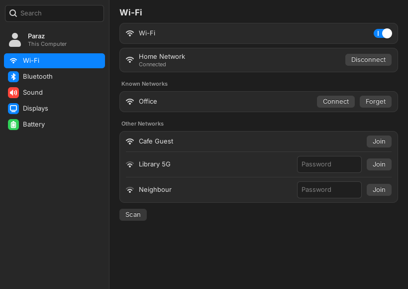
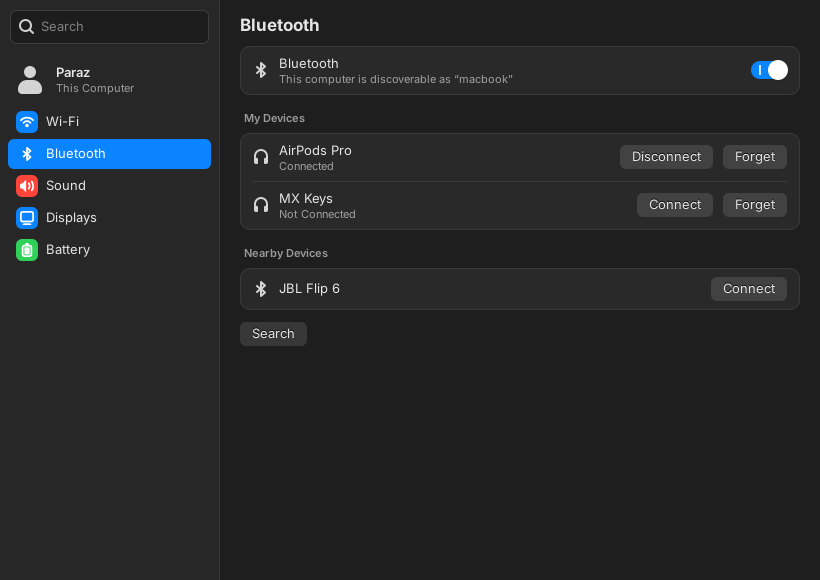
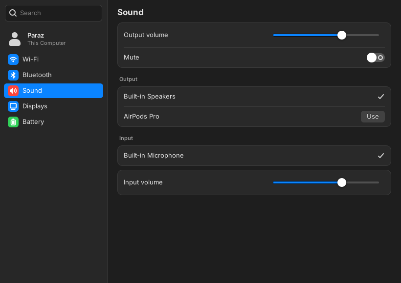

# ⚙️ System Settings for Hyprland

A **macOS Sequoia-style System Settings app** for Linux on Hyprland. It's a small GTK 3 app that puts Wi-Fi, Bluetooth, Sound, Displays and Battery in one window that looks and feels like the Mac's, using the tools your system already has.

| Wi-Fi | Bluetooth | Sound |
|---|---|---|
|  |  |  |

*Screenshots use sample data.*

## What it does

| Pane | What you can do | Uses |
|---|---|---|
| **Wi-Fi** | Turn it on or off, see and switch networks, join new ones (password field inline), forget saved ones | `nmcli` (NetworkManager) |
| **Bluetooth** | Power, pair, connect, disconnect and forget devices, and scan for nearby ones | `bluetoothctl` (BlueZ) |
| **Sound** | Output and input volume, mute, and choosing the speaker or microphone | `wpctl`, `pactl` (PipeWire) |
| **Displays** | Resolution and refresh rate, brightness, and Night Shift | `hyprctl`, `brightnessctl`, `wlsunset` |
| **Battery** | Charge, status and the power mode (Power Saver / Balanced / Performance) | `/sys/class/power_supply`, `powerprofilesctl` |

Other touches:
- A search field filters the sidebar.
- `system-settings bluetooth` opens straight on a pane (same for `wifi`, `sound`, `displays`, `battery`).
- Only one window ever opens.
- ⌘W / Ctrl+W closes it.

**Security:** when you join a Wi-Fi network, the password goes to `nmcli` on its input, never on the command line, so other programs can't read it from the process list.

## Install

```bash
git clone https://github.com/parasharkhangembam-ctrl/hypr-system-settings.git
cd hypr-system-settings
./install.sh
```

It installs to `~/.local/bin` and your app launcher. No `sudo`. Requirements: Python 3 with PyGObject and GTK 3. On Fedora: `sudo dnf install python3-gobject gtk3`.

Open it with ⌘, (Super + comma) like on a Mac, by adding this line to `hyprland.lua`:

```lua
hl.bind("SUPER + comma", hl.dsp.exec_cmd("$HOME/.local/bin/system-settings"))
```

It looks best with a dark GTK theme and the SF Pro font, but it sets its own colours, so it stays readable with any theme.

## Part of a bigger project

I'm building a complete macOS-style desktop on Fedora + Hyprland from scratch. This app is one piece. The **Appearance** pane (accent colour, Dock size) only appears when that desktop's theme engine is installed. Also see [Genie](https://github.com/parasharkhangembam-ctrl/hypr-genie), the macOS Genie minimise animation for Hyprland.

## Credits

Made by **Parashar Khangembam**, written with help from Claude (Anthropic). MIT licence, see [LICENSE](LICENSE).
